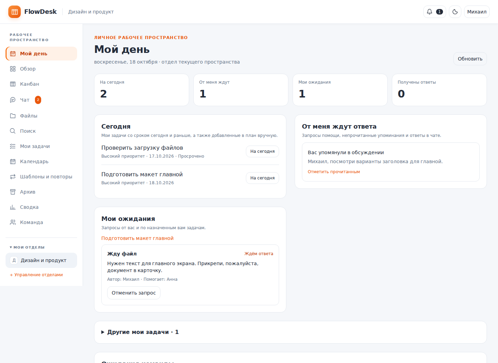
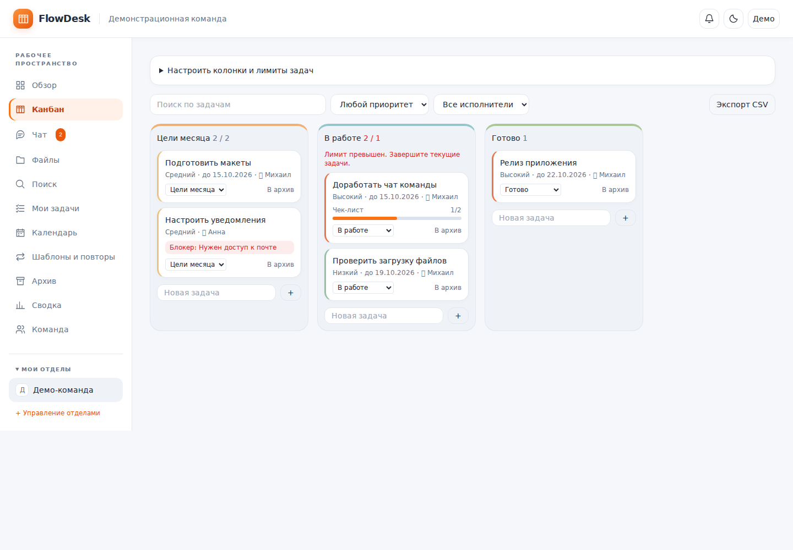
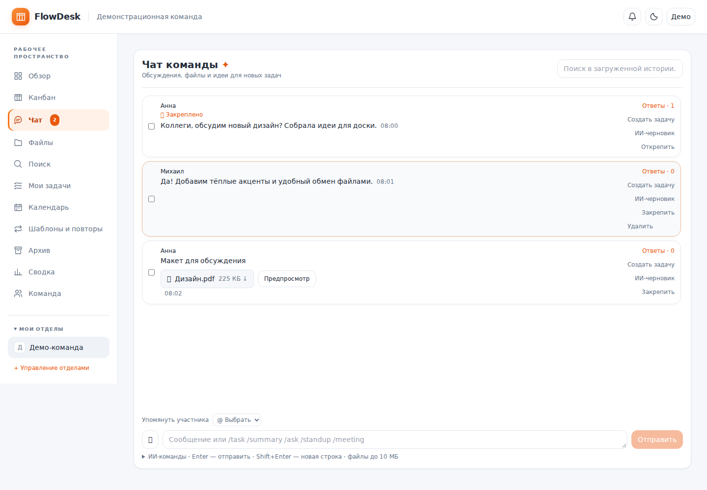
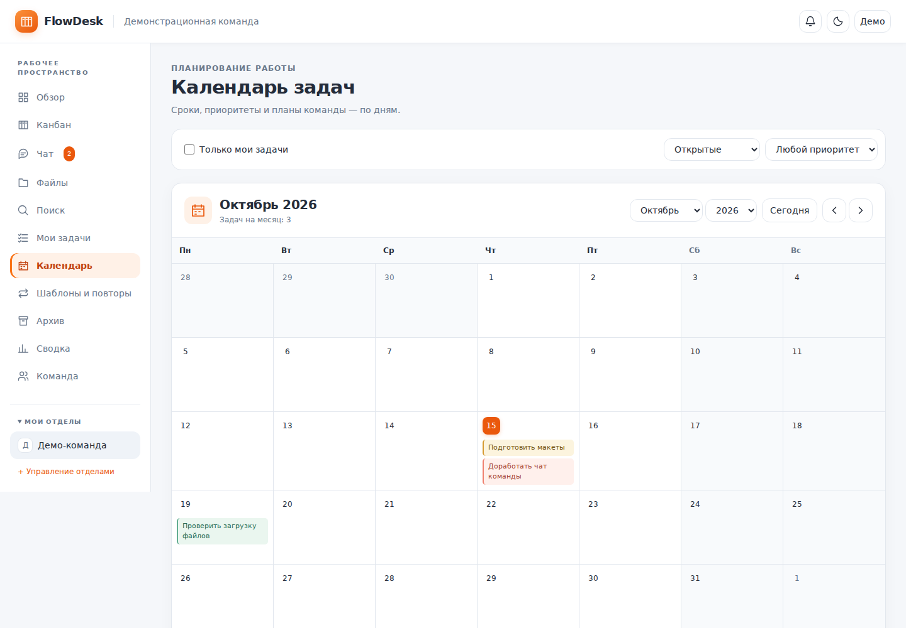
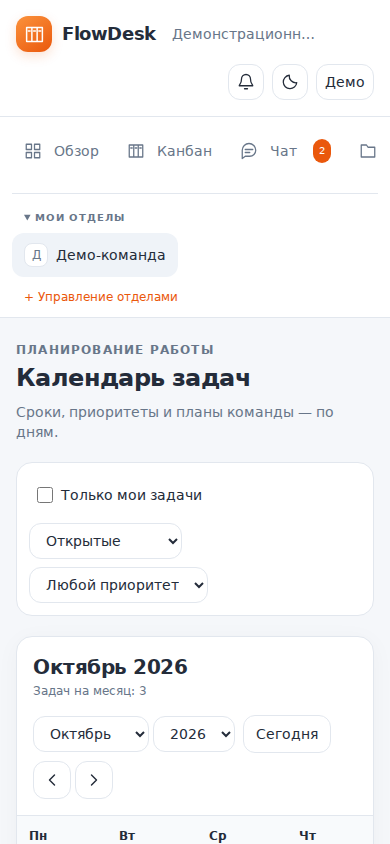

# FlowDesk

<!-- project-links:start -->
**Приложение:** https://flowdesk-alpha-teal.vercel.app  
**Исходный код:** https://github.com/meowzie081/flowdesk
<!-- project-links:end -->

[Деплой и CI/CD](docs/DEPLOYMENT.md) · [GA4](docs/ANALYTICS.md) · [Работа с AI](docs/AI_DEVELOPMENT.md) · [Сценарий защиты](docs/DEMO.md) · [Требования проекта](docs/REQUIREMENTS.md)

Адаптивное веб-приложение для команд. Экран **«Мой день»** собирает задачи, запросы помощи и обсуждения, требующие внимания. Канбан, чат, файлы и AI сохраняют контекст работы внутри отдела.

## Email, push и первое знакомство

- **Объявления**: владелец отдела создаёт рассылку через предпросмотр. Участники видят её в приложении; email и Web Push доставляются подписавшимся пользователям через серверную очередь.
- **Профиль → Уведомления**: независимые настройки писем о событиях, email-объявлений и push. Все внешние каналы выключены до согласия пользователя. Для email нужна реальная подтверждённая почта; для Web Push — поддерживаемый браузер/PWA и явное разрешение.
- **Обучение**: пять визуальных шагов при первом открытии рабочего пространства, «Пропустить», сохранение прогресса в аккаунте и повторный запуск из профиля.

Для обновления уже настроенного проекта выполните **только миграцию `0014_delivery_onboarding.sql`** (после 0001–0013), обновите исходники и опубликуйте. Для доставки настройте Resend, VAPID и отдельный Cron. Старый Cron повторяющихся задач остаётся.

Подробная настройка, пример Cron, Docker-worker и сценарий проверки: **[docs/NOTIFICATIONS.md](docs/NOTIFICATIONS.md)**. Код не отправляет письма при сборке или тестах. Объявления внутри приложения и обучение работают без почтового провайдера.

## Telegram и Desktop

FlowDesk можно открыть внутри Telegram Mini App или в отдельном десктопном окне. Аккаунт, отделы, задачи и файлы остаются общими. Обе версии используют опубликованный сайт и требуют интернет.

- **Telegram:** стартовая страница `/telegram`, бот с командами `/start`, `/app`, `/help`, парольный вход, тема, безопасные отступы и кнопка «Назад». Настройка токена и webhook: [docs/TELEGRAM.md](docs/TELEGRAM.md).
- **Desktop:** приложение Electron в `desktop/`, отдельная сессия, меню, горячие клавиши и восстановление окна. Запуск, сборка и ограничения: [docs/DESKTOP.md](docs/DESKTOP.md).
- **Установщики:** workflow GitHub Actions `Desktop installers` собирает Mac Apple Silicon, Mac Intel, Windows x64/ARM64 и Linux x64 после проверок. Запускается вручную через Actions.

Быстрый запуск десктопного клиента из корня проекта (Node.js 22+):

```bash
npm --prefix desktop ci
npm run desktop:dev
```

Для запуска бота создайте его через BotFather, задайте серверные `TELEGRAM_BOT_TOKEN`, `TELEGRAM_WEBHOOK_SECRET`, `FLOWDESK_PUBLIC_URL` в Vercel и своём `.env`, опубликуйте код, затем выполните `npm run telegram:setup`. Подробный порядок — в инструкции выше. Новая миграция для этих клиентов не требуется.

Это сетевые клиенты с входом по паролю FlowDesk. Привязки Telegram-профиля, рабочих Telegram-рассылок, полноценного офлайн-режима и автоматического обновления установленных Electron-сборок пока нет.

### Windows 11

Подготовлен NSIS-установщик FlowDesk: выбор папки, ярлык, меню «Пуск» и удаление через настройки Windows. Клиент использует общий аккаунт и опубликованный сайт. Подробно: [docs/WINDOWS11.md](docs/WINDOWS11.md).

Сборка на Windows из корня проекта:

```powershell
npm --prefix desktop ci
npm --prefix desktop run dist:win:x64
```

Для Windows на ARM: `npm --prefix desktop run dist:win:arm64`. Установщики без цифровой подписи издателя, на настоящей Windows 11 в среде подготовки не тестировались.

## Мой день

Откройте отдел: первой страницей станет **«Мой день»**. Раздел также доступен в боковом меню.

- **Сегодня:** назначенные вам незавершённые задачи со сроком сегодня и раньше. Любую другую свою задачу можно добавить кнопкой «На сегодня», не меняя её срок. План привязан к дате по времени устройства.
- **От меня ждут ответа:** адресованные вам запросы помощи, непрочитанные упоминания и ответы в чате. Отметка «прочитано» убирает уведомление, а не означает, что вы ответили.
- **Мои ожидания:** ваши запросы и запросы по назначенным вам задачам, а также причины блокировки из карточек.
- **Продолжить работу:** последняя открытая карточка в этом отделе и браузере. Сохраняется только ID карточки, отдельно для каждого аккаунта. Архивные и недоступные карточки не предлагаются.
- **Ожидания команды:** остальные активные запросы отдела для владельца.

### Запрос помощи

1. В карточке нажмите **«Запросить помощь»**.
2. Выберите активного коллегу с правом записи, причину («Жду файл», «Нужен доступ», «Нужно решение» или «Другое») и опишите запрос.
3. Коллега увидит запрос в своём дне и колокольчике. Он отвечает прямо на экране; файлы прикладывает в карточке задачи.
4. Автор получает уведомление и нажимает **«Работа продолжена»** после проверки ответа. До этого запрос остаётся активным со статусом «Ответ получен».

На задачу допускается один активный запрос. Автор и владелец могут отменить запрос, после закрытия можно создать новый. Запрос не меняет вручную введённую причину блокировки или колонку. Наблюдатель читает доступные данные, но не отправляет запросы и ответы. Права проверяются PostgreSQL, включая блокировку участников. Экран обновляется каждые 15 секунд и при возврате во вкладку.



### Обновление уже опубликованного приложения

Для перехода с версии до «Моего дня» сначала выполните миграцию `supabase/migrations/0013_my_day.sql` в SQL Editor своего Supabase-проекта. Повторно запускать старые миграции не требуется. Затем загрузите обновлённый код в GitHub и дождитесь деплоя Vercel. Настроенный Supabase Cron менять не нужно.

Проверка с двумя аккаунтами: создайте запрос помощи из карточки, ответьте со второго аккаунта, вернитесь первым и подтвердите продолжение работы. Проверьте, что добавление в дневной план не меняет срок задачи.

Подробные правила и порядок обновления: [docs/MY_DAY.md](docs/MY_DAY.md).

## Быстрый старт (MacBook)

```bash
cd flowdesk
npm install
cp .env.example .env          # заполните ключи
npm run dev                   # http://localhost:3000
```

### База данных (Supabase)

1. Создайте проект на supabase.com (или `npx supabase start` локально).
2. В SQL Editor по порядку выполните:
   - `supabase/migrations/0001_schema.sql` — таблицы, RLS, роли;
   - `supabase/migrations/0002_task_event_triggers.sql` — события для дайджеста;
   - `supabase/migrations/0003_storage.sql` — bucket `attachments` и политики доступа к файлам;
   - `supabase/migrations/0004_fix_new_user_trigger.sql` — исправление триггера регистрации;
   - `supabase/migrations/0005_invites_digest.sql` — приглашения по email и устойчивый дайджест;
   - `supabase/migrations/0006_comments_labels_notifications.sql` — комментарии, метки, уведомления;
   - `supabase/migrations/0007_profile_customization.sql` — иконка и цвет ника в профиле;
   - `supabase/migrations/0008_realtime_messages.sql` — мгновенные сообщения в чате;
   - `supabase/migrations/0009_chat_files.sql` — вложения и удаление сообщений;
   - `supabase/migrations/0010_collaboration.sql` — все функции совместной работы;
   - `supabase/migrations/0011_managed_accounts.sql` — логины создаваемых администратором пользователей;
   - `supabase/migrations/0012_workflow.sql` — доступ, журнал, архив, зависимости, шаблоны, повторы и поиск;
   - `supabase/migrations/0013_my_day.sql` — дневные планы, запросы помощи, уведомления и проверки прав;
   - `supabase/migrations/0014_delivery_onboarding.sql` — email/Web Push, объявления, настройки и обучение.
3. Authentication → Providers → включите Email и Google (OAuth).
4. Realtime для чата включается миграцией `0008_realtime_messages.sql` (вручную в Replication ничего включать не нужно).
5. Скопируйте URL и anon key (Project Settings → API) в `.env`.

### ИИ

В `.env` выберите `AI_PROVIDER=gemini` или `groq` и вставьте ключ. Ключи читаются только на сервере
(`src/app/api/ai/route.ts`), в браузер не попадают.

## Что реализовано

| Область | Файлы |
|---|---|
| Базовые таблицы, RLS, роли owner/member/viewer | `supabase/migrations/0001_schema.sql` |
| Вход (email + Google OAuth), валидация | `src/app/login`, `src/middleware.ts` |
| Дашборд, «Что я пропустил», радар блокеров | `src/app/d/[depId]/page.tsx`, view `stuck_tasks`, триггеры `0002` |
| «Мой день», дневной план и запросы помощи | `MyDay.tsx`, `TaskHelp.tsx`, `0013_my_day.sql` |
| Канбан: CRUD, поиск, фильтр, перетаскивание мышью | `src/components/Board.tsx` |
| Карточка: редактирование, срок, файлы (до 10 МБ) | `src/components/TaskDetail.tsx`, `0003_storage.sql` |
| Чат (realtime) + чат → задачи с подтверждением | `src/components/Chat.tsx` |
| Слэш-команды `/task /summary /ask /standup` (`/ask` и `/standup` читают доску) | `src/lib/ai/commands.ts`, `prompts.ts`, `boardContext.ts` |
| ИИ-резюме дайджеста и подсказки по блокерам | `src/components/AiAction.tsx`, `src/app/d/[depId]/page.tsx` |
| Комментарии, метки, уведомления (колокольчик, Realtime), экспорт CSV | `TaskDetail.tsx`, `NotificationBell.tsx`, `api/export/route.ts`, `0006_...sql` |
| Приглашения по email, роли, удаление участника | `src/app/d/[depId]/team/page.tsx`, `0005_invites_digest.sql` |
| Исполнитель, фильтр по исполнителю, порядок карточек | `src/components/Board.tsx`, `TaskDetail.tsx` |
| Приватность ИИ: маскирование и индикатор | `src/lib/ai/mask.ts` (+ тесты) |
| Команда и роли | `src/app/d/[depId]/team` |

На телефоне перетаскивание не работает (ограничение браузера), там карточки переносятся через выпадающий список в карточке.

## Не реализовано

- Письма с приглашениями не отправляются: приглашённый должен сам зарегистрироваться с тем же email, после подтверждения почты он попадёт в отдел автоматически. В продакшене не отключайте «Confirm email» в Supabase.
- Лимит запросов к ИИ: 10 в минуту на пользователя (`RATE_LIMIT_PER_MINUTE` в `src/app/api/ai/route.ts`).

## Проверки

```bash
npm run typecheck && npm test && npm run test:db && npm run build
```

## Docker (локальная сеть)

```bash
docker compose up --build     # http://<ip-мака>:3000
```

## Деплой

Текущая опубликованная схема: **Vercel + Supabase** (Auth, PostgreSQL, Storage, Realtime). Повторяющиеся задачи запускает Supabase Cron, вызывающий `public.run_due_recurring()` каждую минуту. Постоянный Docker worker на Vercel не нужен.

В Vercel перед сборкой настроены проверка типов, unit-тесты и проверки БД. Для нового кода сначала применяйте миграцию, затем отправляйте изменения в GitHub. Docker Compose и Caddy остаются альтернативой для VPS. Инструкция: [docs/DEPLOYMENT.md](docs/DEPLOYMENT.md).

## Планы развития

смысловой поиск, голосовые сообщения, Telegram.


## Ollama, PWA, тёмная тема

- **Ollama (локальная модель, данные не уходят наружу).** Установите Ollama, выполните `ollama pull llama3.2`,
  в `.env` задайте `AI_PROVIDER=ollama` (при необходимости `OLLAMA_URL`, `OLLAMA_MODEL`) и перезапустите `npm run dev`.
  Работает там, где запущен сам Ollama (локально или в Docker Compose с профилем `ollama`), но не на Vercel.
- **PWA.** В production-сборке (`npm run build && npm start` или Vercel, нужен HTTPS либо localhost)
  браузер предложит установить FlowDesk как приложение. Offline-режим только показывает страницу «Нет соединения».
- **Тёмная тема.** Кнопка ☾/☀ в шапке; по умолчанию берётся системная тема, выбор запоминается в браузере.


## Фирменные функции (этап 4)

- **Загрузка команды** (дашборд): у кого сколько открытых задач с учётом приоритета и просрочек, кто перегружен, у кого есть ресурс. Считается без ИИ, `src/lib/analytics.ts`.
- **Риск срыва сроков** (дашборд): оценка по среднему времени жизни задач команды и положению карточки на доске. Для каждой задачи показана причина.
- **Недельный отчёт**: кнопка на дашборде, ИИ собирает «сделано / в работе / риски / планы» по данным доски, можно скачать .md.
- **Контекст чата у карточки**: задача, созданная из чата, показывает исходное сообщение и соседние («Из чата»).
- **`/meeting <заметки>`**: ИИ выделяет решения и задачи из заметок встречи; итоги публикуются в чате, задачи подтверждаются вручную и привязываются к этому сообщению. Shift+Enter — новая строка.

## Профиль и выход

- Меню с именем в правом верхнем углу: «Профиль» и «Выйти» (POST `/auth/signout`).
- Страница `/profile`: имя, иконка (24 эмодзи) и цвет ника (12 готовых + свой). Цвет проверяется на контраст
  в светлой и тёмной теме (`src/lib/profile.ts`), поэтому «невидимый» ник выбрать нельзя.
- Иконка и цвет видны в чате, на доске (исполнитель), в комментариях, на странице команды и в блоке загрузки.

## Демо-данные

`supabase/seed/demo_it_management.sql` — наполняет отделы «IT-отдел» и «Managment» колонками, метками и 14 задачами в каждом
(сроки, исполнители, просрочки, застрявшие карточки). Запуск: Supabase → SQL Editor → вставить файл → Run.
Скрипт пропускает отдел, у которого на доске уже есть задачи, поэтому повторный запуск безопасен.

Аналогично `supabase/seed/demo_design_development.sql` — отделы «Design» (15 задач) и «Development» (16 задач).

## Удаление отдела

«Команда» → блок «Удаление отдела» (виден только владельцу). Нужно ввести название отдела. Файлы задач удаляются из Storage,
остальные данные — каскадом в базе (проверено на тестовой БД); аккаунты участников остаются.

## Чат в реальном времени

Свои сообщения появляются сразу после отправки, чужие — мгновенно через Realtime. Если Realtime недоступен, чат сам проверяет
новые сообщения каждые 4 секунды и при возвращении на вкладку. После удаления отдела (в том числе другим владельцем)
любая страница этого отдела перенаправляет на выбор отдела.

## Обновление чата и интерфейса (12 октября 2026)

Перед запуском обновлённого приложения примените миграцию
`supabase/migrations/0009_chat_files.sql` в Supabase SQL Editor после предыдущих миграций.
Она добавляет поля сообщений, функцию удаления и приватный bucket `chat-files` с RLS.
Без неё новый чат не сможет читать и отправлять сообщения. Настройки подключения
остаются в `.env.local` (см. `.env.example`).

- Удаление своих сообщений с подтверждением; удалённый текст не попадает в контекст ИИ.
  Удаление синхронизируется через Realtime UPDATE и резервный опрос. Связь исходной
  карточки с удалённым сообщением снимается. Файлы удаляются из Storage после сообщения;
  при ошибке очистки чат сообщает об этом.
- До 5 вложений по 10 МБ: кнопка скрепки, перетаскивание, удаление из черновика,
  отправка без текста, приватное скачивание по временной ссылке. Вложения не отправляются ИИ.
- Поиск по тексту и названиям файлов в загруженной истории; история загружается по 100 сообщений.
- При ошибке отправки текст и список вложений сохраняются для повторной попытки.
- Тёплая палитра, оранжевые акценты, цветные колонки и приоритеты карточек,
  оформление собственных сообщений; сохранены светлая и тёмная темы.

Проверка: `npm ci`, `npm run typecheck`, `npm test`, `npm run build`.
Для проверки RLS и Realtime используйте два аккаунта в одном отделе и аккаунт
в другом отделе: viewer не должен отправлять или удалять сообщения; участник
другого отдела не должен читать файлы. Эти проверки требуют настроенного Supabase.


## Совместная работа: обновление от 13 октября 2026

Если предыдущая версия уже установлена и миграция `0009_chat_files.sql` выполнена,
примените **только `0010_collaboration.sql`**, затем обновите приложение. Для новой
базы применяйте миграции `0001`–`0010` по порядку. Миграции `0009` и `0010` выполняются
один раз. Не запускайте их повторно на уже обновлённой базе.

### Восемь доработок

1. **Задача из сообщения.** Кнопка «Создать задачу» создаёт карточку в первой
   незавершённой колонке и показывает ссылку. Повторный клик возвращает ту же карточку
   на этой доске. Исходное обсуждение доступно из карточки. «ИИ-черновик» использует
   существующую команду `/task`; создание предлагаемых ИИ карточек требует подтверждения.
2. **Ветки.** «Ответы» открывает отдельное обсуждение. Отправка в открытой ветке
   создаёт ответ; ответы на ответы относятся к одной корневой ветке. Удаление корня
   не удаляет ответы. Глубокая ссылка `chat?message=<id>` открывает нужное обсуждение.
3. **Упоминания и непрочитанное.** Введите `@` и выберите участника в подсказках или
   используйте список над полем ввода. Выбранный участник получает уведомление, автор
   корневого сообщения — уведомление об ответе. Непрочитанное учитывается отдельно
   по каждому отделу и пользователю, синхронизируется между устройствами. «К первому
   непрочитанному» открывает сообщение, «Отметить прочитанным» отмечает сообщения до
   текущего последнего. Вход в чат сам по себе не стирает счётчик. Индикатор — в боковом меню.
4. **Чек-листы.** Добавление, отметка выполнения и удаление отдельных пунктов в
   карточке; прогресс на доске. Пункты сохраняются отдельно, чтобы изменения одного
   участника не перезаписывали весь список другого. Причина блокировки сохраняется
   вместе с основными полями карточки и показывается на доске.
5. **Колонки и WIP.** Добавление, название, цвет, порядок, признак завершения и лимит
   задач. Превышение лимита предупреждает, но не запрещает перемещение. Счётчик
   учитывает все задачи колонки, независимо от фильтров. Непустую и последнюю колонки
   удалить нельзя. Порядок колонок и перемещение карточек сохраняются атомарно.
6. **Файлы отдела.** Раздел «Файлы» объединяет вложения карточек и неудалённых
   сообщений. Поиск по имени, фильтры автора, источника и даты загрузки, страницы по
   50 файлов, приватное скачивание и переход к источнику. Даты фильтра — московское время.
7. **История карточки.** Автор, время, прежнее и новое значение названия, описания,
   приоритета, срока, блокера, исполнителя и колонки. Изменения чек-листа и комментарии
   тоже попадают в историю. Журнал заполняют серверные триггеры, клиент не может
   подделывать события. Предыдущие события сохранены; старые изменения полей,
   которые раньше не записывались, восстановить невозможно.
8. **Ежедневная сводка.** Раздел «Сводка» и блок на дашборде: завершения и важные
   обсуждения за выбранный день, текущие просрочки и блокеры. Важными считаются
   закреплённые сообщения, упоминания и ответы. Чат позволяет закреплять сообщения.
   Блокеры — явная причина блокировки или более трёх дней без перемещения в рабочей
   колонке. День определяется по Москве. Счётчики рассчитываются в базе, списки
   ограничены 50 задачами и 20 обсуждениями с указанием общего количества.
   Автоматическая рассылка не требуется: сводка строится при открытии страницы и
   работает без ключа ИИ. Для прошлой даты просрочки и блокеры показывают текущую
   доску, а не исторический снимок.

Интерфейс: боковое меню разделов и отделов, открытие карточки справа поверх доски,
закрытие Escape, управление фокусом, адаптивная компоновка, светлая и тёмная темы.
Доска обновляет данные каждые 10 секунд и при возвращении фокуса; чат — через
Realtime и резервный опрос; уведомления и непрочитанное — с резервным опросом.

### Проверки

```bash
npm ci
npm run typecheck
npm test
npm run test:db
npm run build
```

`test:db` применяет все миграции на PGlite (PostgreSQL в WASM), с тестовыми
схемами Auth/Storage, и проверяет RLS/роли, изоляцию отделов, ветки, уведомления,
прочтение, создание задач, историю, файлы, колонки и сводку. Он не подключается
к вашему проекту Supabase и не меняет его данные. Для production-проверки
Storage/Realtime используйте реальный тестовый Supabase с двумя участниками,
viewer и участником другого отдела.

Проверки этой версии: типы и production-сборка прошли; 47 модульных тестов,
53 проверки базы данных. В Chromium с тестовым Supabase проверены создание
задачи из сообщения, ветки, упоминания, отправка/удаление вложений, прочтение,
чек-листы, создание колонок, WIP-предупреждения, поиск файлов, мобильная ширина
и тёмная тема. Живые Supabase Storage и доставка Realtime не проверялись.


## Создание пользователей администратором

Администратор в этой версии — владелец отдела (`owner`). В разделе **Команда →
Создать пользователя** он задаёт имя, уникальный логин, пароль и роль в отделе
(участник, наблюдатель или администратор). Новый пользователь сразу входит на
странице входа по логину и паролю, без самостоятельной регистрации и подтверждения
почты. Обычные аккаунты продолжают входить по email; Google OAuth сохранён.

Для обновления версии после `0010`:

1. Примените `supabase/migrations/0011_managed_accounts.sql` в SQL Editor один раз.
2. Укажите **SUPABASE_SERVICE_ROLE_KEY** в серверном `.env`/`.env.local` или переменной
   окружения хостинга. Значение берётся в настройках API вашего Supabase. Это секретный
   серверный ключ; не добавляйте `NEXT_PUBLIC_` и не размещайте его в клиентском коде.
3. Перезапустите приложение (при Docker: `docker compose up -d --build`).
4. Откройте раздел «Команда» под владельцем отдела и создайте пользователя.

Логины глобально уникальны, без учёта регистра: 3–32 латинских буквы, цифры, точки,
дефисы или подчёркивания, первый символ — буква или цифра. Завершающая и двойная
точка запрещены. Пароль — 8–128 символов; дополнительно действуют настройки Auth
вашего Supabase. Существующему аккаунту пароль не меняется при совпадении логина.

Внутри Supabase Auth логин сопоставляется с адресом `<login>@users.flowdesk.invalid`.
Это технический адрес, почта для него не отправляется; в интерфейсе отображается
логин. Для этих аккаунтов восстановление через почту не подходит. Пароли передаются
только в Auth API; в таблице `managed_accounts` их нет. Секретный ключ импортируется
через модуль `server-only`. Сам пользователь не может менять свой логин через
таблицу; участники видят логины только общих отделов.

Сервер повторно проверяет сессию и роль владельца. Привязка нового пользователя к
отделу выполняется с сессией администратора и RLS. При ошибке реестра или привязки
созданный аккаунт удаляется; если очистка тоже не удалась, интерфейс сообщает о
необходимости проверить Supabase Auth. Создание Auth-пользователя и запись в БД
не являются единой транзакцией: при потере ответа Auth API стоит проверить,
не появился ли аккаунт, перед повторным созданием.

Проверки: 60 модульных тестов, 58 проверок БД на 11 миграциях, типы и сборка.
Форма проверена в Chromium с тестовым API (успех, занятый логин, скрытие/показ
пароля, очистка после успеха, мобильная ширина). Реальное создание аккаунта в
вашем Supabase не выполнялось.


## Все десять доработок: обновление от 14 октября 2026

Для базы, уже обновлённой до `0011`, примените **только
`supabase/migrations/0012_workflow.sql`** один раз. Для новой базы выполните все
миграции `0001`–`0012` по порядку. После миграции обновите приложение:

```bash
docker compose up -d --build
docker compose ps
docker compose logs --tail=100 scheduler
```

В `.env` должны быть действительные `NEXT_PUBLIC_SUPABASE_URL`,
`NEXT_PUBLIC_SUPABASE_ANON_KEY` и серверный `SUPABASE_SERVICE_ROLE_KEY`.
Compose теперь запускает два процесса: `web` и `scheduler`. Приложение
слушает `0.0.0.0:3000`; scheduler не открывает портов. Без Docker запускайте
`npm run dev` и, в отдельном терминале из корня проекта, `npm run worker`.
Worker читает `.env.local`/`.env`, если переменные не переданы окружением.
На хостинге без Docker worker нужно запустить как отдельный постоянный Node-процесс;
альтернатива — вызывать защищённую RPC `run_due_recurring` из серверного планировщика.
Открытие страницы само по себе расписания не выполняет.

| Доработка | Где находится и как работает |
| --- | --- |
| Смена и сброс пароля | В профиле — смена со вводом текущего пароля. Свежая отдельная сессия Auth проверяет пароль; после успеха нужно войти снова. В «Команде» владелец может сбросить пароль аккаунта, который он сам создал. Обычные приглашённые аккаунты и аккаунты другого администратора так изменить нельзя. |
| Блокировка пользователей | «Команда → Приостановить доступ к отделу». Членство, задачи, сообщения и журнал остаются. RLS закрывает чтение и запись, в том числе со старой действующей сессией. Уведомления этого отдела тоже скрываются. Другие отделы пользователя не блокируются. Самого себя и последнего активного владельца блокировать нельзя. |
| Зависимости | В карточке: «Зависит от задач». Связываются карточки одной доски; циклы и ссылки на себя запрещены. На доске показано количество незавершённых предшественников. Пока предшественники не завершены, перемещение карточки в завершённую колонку запрещено. Уже завершённые карточки не отменяются автоматически, если предшественник открыт повторно. |
| Календарь и «Мои задачи» | Разделы бокового меню. Личные задачи, открытые/завершённые, приоритет, просрочки, сегодня, ближайшие 7 дней, без срока. Календарь по месяцам, переход к карточкам и списку задач выбранного дня. День определяется по Москве. |
| Повторяющиеся задачи | «Шаблоны и повторы → Повторять». Дни, недели или месяцы, интервал, дата начала, рабочая колонка и назначение себе. Изменение, пауза, возобновление, удаление расписания. Scheduler проверяет базу каждую минуту. После простоя/паузы создаёт пропущенные даты, по 50 на правило за проход, до 50 правил за проход. Уникальная пара «правило + дата» и блокировки исключают повторную генерацию той же даты. Если автор потерял право создавать задачи или исполнитель недоступен, правило останавливается с причиной. После устранения причины включите его снова. |
| Шаблоны карточек | «Шаблоны и повторы»: название, описание, приоритет, срок через N дней, чек-лист. Карточка также сохраняется как шаблон из её сохранённой версии. Создание из шаблона — одна транзакция, новые пункты чек-листа не выполнены. Изменение шаблона влияет на будущие повторения; созданные карточки не меняет. Удаление шаблона удаляет его расписания, но сохраняет созданные задачи. |
| Поиск по отделу | «Поиск»: задачи (название/описание), сообщения (текст) и файлы (название). Фильтр типа, архив задач, страницы по 30 результатов. Только данные доступного отдела. Содержимое PDF/документов не индексируется. |
| Архив задач | «В архив» на доске или «Архивировать карточку» в карточке. Раздел «Архив» позволяет просмотреть и восстановить задачу. Карточка, чек-лист, комментарии, вложения и история сохраняются. Архив исключён из канбана, текущей нагрузки, просрочек, календаря и ИИ-контекста доски. События завершения остаются в исторической сводке. Колонку нельзя удалить, пока в ней есть задачи, включая архив, или расписания. |
| Предпросмотр файлов | Кнопка рядом с вложениями чата, карточек и в «Файлах». PNG, JPEG, GIF, WebP и PDF открываются в приложении. Доступ проверяется перед чтением из приватного Storage; MIME определяется по сигнатуре. HTML/SVG и другие активные форматы не показываются. PDF использует встроенный просмотрщик браузера; при отсутствии поддержки скачайте файл. |
| Журнал администратора | «Команда → Журнал администратора». Создание аккаунта, добавление/удаление участника, роли, приостановка/восстановление доступа, запрос и результат сброса пароля. Имена сохраняются на момент действия; паролей и ключей нет. Читать могут только активные владельцы, клиент не может создавать, изменять или удалять записи. Журнал начинается с применения этой миграции; прошлые административные действия восстановить невозможно. |

Ежемесячное повторение сохраняет день первого запуска: 31 января → 28/29 февраля
→ 31 марта. Изменение следующей даты вручную задаёт новый опорный день.
Пароли меняются через Supabase Auth API. Журнал сохраняет запрос до обращения к
Auth; если запрос был прерван, он останется с состоянием «запрос сохранён».
Изменение Auth-пароля и фиксация результата в PostgreSQL не являются единой
транзакцией. Сброс пароля не обещает немедленное завершение всех ранее выданных JWT;
для немедленного закрытия доступа к отделу используйте блокировку.

### Проверки новой версии

```bash
npm ci
npm run typecheck
npm test
npm run test:db
npm run build
```

Проверены API смены/сброса пароля с тестовым Auth, RLS со старой сессией после
блокировки, неизменяемость журнала, циклы и завершение зависимостей, архив/поиск,
создание из шаблона, идемпотентность повторений и календарные даты. В Chromium с
тестовым Supabase пройдены основные сценарии всех новых клиентских экранов,
предпросмотр изображения и мобильная ширина. Worker проверен на тестовом HTTP
сервере: заголовки авторизации, вызов RPC, отсутствие ключа в логах, остановка.
Конфигурация Compose и копирование worker в Dockerfile проверены статически.
Живой Supabase Auth/Storage/Realtime и сборка Docker-образа в этой среде
не выполнялись; Docker Engine здесь недоступен.


## Обновление календаря и интерфейса — 15 октября 2026

- Календарь показывает только необходимые недели (4, 5 или 6), начиная с понедельника. Октябрь 2026 заканчивается строкой с 1 ноября, без лишней недели.
- Русское название месяца, выбор месяца и года, стрелки перехода и кнопка «Сегодня».
- В сетке видны задачи соседних месяцев. Нажатие на соседнюю дату открывает её месяц и список задач дня.
- Цвета приоритетов, подсветка сегодняшней и выбранной даты, раскрытие задач дня, читаемые даты в списке.
- Обновлены светлая и тёмная палитры, навигация, иконки, шапка, поля и карточки. На телефоне меню и календарь прокручиваются внутри своих блоков.

Обновление не требует новых SQL-миграций. При замене файлов проекта сохраните свой `.env`, затем пересоберите контейнеры:

```bash
docker compose up -d --build
```


## Интерфейс

Изображения ниже сняты с компонентов проекта на демонстрационных данных, без подключения к рабочему Supabase.

### Канбан


### Чат


### Календарь


### Телефон


## Google Analytics 4

В `.env` задайте `NEXT_PUBLIC_GA_ID=G-...`, затем пересоберите приложение. До разрешения пользователя Google tag не загружается. Просмотры разделов и успешные действия отправляются без текстов задач/чата и без идентификаторов объектов. Настройка потока GA4, список событий и проверка описаны в [docs/ANALYTICS.md](docs/ANALYTICS.md).

## Материалы для защиты

- [Идея, User Stories и критерии приёмки](docs/REQUIREMENTS.md)
- [Архитектура и безопасность](docs/ARCHITECTURE.md)
- [Процесс разработки с AI и примеры промптов](docs/AI_DEVELOPMENT.md)
- [Сценарий демонстрации на 7–9 минут](docs/DEMO.md)
- [Презентация](docs/presentation/FlowDesk_defense.pptx)

Базовая версия опубликована на Vercel; работа основных сценариев, AI, GA4 и Supabase Cron подтверждена пользователем. Новое обновление «Мой день» подготовлено локально и требует применения миграции 0013 и публикации кода.

Проверка обновления от 18 октября: 102 unit-теста, 148 SQL/RLS-проверок на 13 миграциях, TypeScript и production-сборка прошли. Сценарий «Моего дня» проверен в Chromium на компонентах с демонстрационными данными, включая ширину 390 px. Новая версия на публичном адресе ещё не проверялась. Фактический SSH-деплой и сборка Docker-образа при подготовке обновления не выполнялись.


## Исправление Origin при запуске в Docker — 17 октября 2026

Ошибка «Недопустимый источник запроса» могла возникать при создании пользователя,
смене или сбросе пароля: внутренний URL Next.js содержал адрес контейнера вместо
адреса браузера. Эти три API теперь используют общую проверку Origin по Host и
протоколу запроса. Поддерживаются localhost, IP локальной сети и HTTPS за Caddy.
Прокси должен сохранять Host и перезаписывать X-Forwarded-Proto. Клиентский
X-Forwarded-Host не используется для разрешения доступа. Чужие Origin, порты,
протоколы, cross-site и некорректные заголовки отклоняются.

Замените `src/lib/http.ts` и `src/app/api/admin/users/route.ts`, затем выполните
`docker compose up -d --build`. `.env` и SQL-миграции менять не требуется.
Добавлены 7 регрессионных тестов; всего 99 unit-тестов.

## Обновление от 18 октября: Telegram Mini App и Desktop

Серверный webhook не использует сессию Supabase и проверяет отдельный секретный заголовок Telegram. Mini App не получает права на основании Telegram-профиля. Десктопный клиент не имеет Node.js API в веб-странице.

Проверки кода клиентов: 116 unit-тестов веб-проекта, 148 SQL-проверок, 5 проверок политики десктопного клиента, TypeScript и production-сборка. Реальный бот требует ваших ключей и опубликованного webhook. Подробности сборки и проверки десктопа — в docs/DESKTOP.md.

## Обновление от 20 октября: email, Web Push и обучение

В исходники добавлены объявления/рассылки владельца отдела, независимое согласие на каналы, серверная очередь с повторными попытками, браузерные push и обучение с пропуском/повторным запуском. Конфигурация и обновление: [docs/NOTIFICATIONS.md](docs/NOTIFICATIONS.md). Docker и CI используют Node.js 22. Неавторизованные API-запросы возвращают JSON 401, страницы по-прежнему перенаправляют на вход.

Проверено: **144 теста приложения, 181 SQL/RLS-проверка на 14 миграциях, 5 desktop-проверок**, TypeScript и production-сборка. В Chromium проверены первый показ, сохранение пропуска, повторный запуск, завершение и Escape, настройки email, предпросмотр перед публикацией и ширина 390 px. UI проверялся с подменёнными API; доставка — с моками транспортов. Настоящие письма/push не отправлялись; миграция и новая версия в рабочем Supabase/Vercel здесь не применялись.
